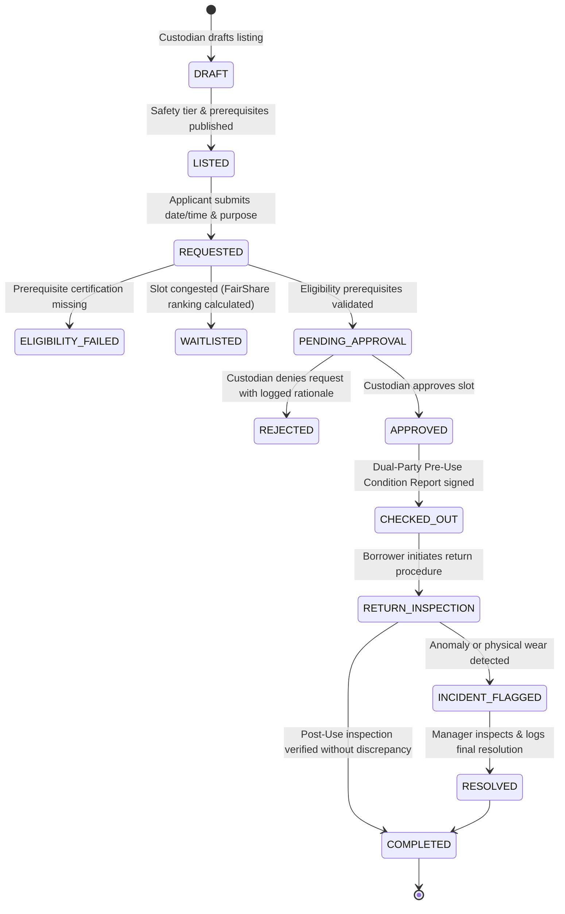

# NEXUS — Trusted Resource Sharing Network
**Project Documentation & Technical Evaluation Brief**  
*Code Conquer Hackathon 2026 Submission*

---

## 1. Executive Summary & Selected Use Case

### The Problem
Universities, makerspaces, corporate research laboratories, and advanced technical facilities possess millions of dollars in specialised equipment—ranging from High-Performance Liquid Chromatography (HPLC) units and vertical CNC mills to dual-extrusion 3D printers and acoustic isolation chambers. 

Field analysis reveals that these assets operate at only **20% to 40% capacity** during standard work cycles. Meanwhile, early-stage hardware founders, student researchers, and community makers lack capital to purchase or rent commercial facility time. 

Standard room-booking tools fail to address the core barriers:
1. **Fear of Unaccountable Damage:** Custodians refuse public booking due to lack of verified condition auditing.
2. **Safety & Credential Barriers:** High-hazard or high-precision equipment requires validated training induction.
3. **Resource Monopolisation:** Single teams repeatedly hoard limited prime-time slots.
4. **Lack of Verifiable Auditability:** Administrative disputes lack tamper-evident timestamped custody records.

### The Solution: NEXUS
**NEXUS** is not a generic booking calendar. Booking is merely the operational mechanism; **trusted resource custody and fair allocation** is the product. 

NEXUS establishes a federated, multi-institution resource-sharing network where verified custodians list high-value machinery with strict eligibility gates, applicants receive priority via an algorithmic **FairShare Engine**, handovers require **Dual-Party Condition Reports with AI Vision Delta Verification**, and all lifecycle transitions are permanently recorded in an **Audit Ledger**.

---

## 2. Target Users & Institutional Participants

| Sector | Target Resource Custodians | Target Borrowers | Typical Shared Resource |
| :--- | :--- | :--- | :--- |
| **Colleges & Universities** | Lab Directors, Department Heads | Graduate researchers, senior engineering students | Haas VF-2 CNC Mills, Cleanroom stations |
| **Corporate R&D** | Operations Managers, Facilities Teams | Incubated startups, external partners | Agilent 1260 HPLC, Anechoic audio testing labs |
| **Makerspaces** | Workshop Technicians, Safety Leads | Hardware creators, rapid prototypers | UltiMaker S5 3D Printers, Trotec Laser Cutters |
| **Media & Audio Hubs** | Studio Managers | Independent cinematographers, podcast creators | Sony FX6 Cinema rigs, sound-isolated booths |

---

## 3. Complete Product Workflow & Lifecycle State Machine

NEXUS implements an immutable 10-step lifecycle governing resource custody:

### Detailed Lifecycle Stages
1. **Listing & Policy Definition:** The owner specifies location, hourly rate/credits, maximum booking duration, mandatory cooldown window (e.g. 48h before rebooking), and safety tier (Tier 1: Open, Tier 2: Certified, Tier 3: Supervised).
2. **Discovery & Smart Filtering:** Borrowers filter by category, facility location, and required credential tiers.
3. **Prerequisite Gating:** The system automatically checks user certification records against required badges (e.g., Cleanroom Safety Level 2, CNC Operator).
4. **FairShare Priority Queueing:** Competing requests for identical windows are ranked mathematically using transparent, anti-hoarding scoring.
5. **Human-in-the-Loop Approval:** Custodians inspect applicant trust scores and research purposes before granting approval.
6. **Pre-Use Handover Inspection:** At hardware checkout, both parties verify clean baseline operating state, capture photographic evidence, and digitally co-sign the report.
7. **Active Custody & Overdue Monitoring:** Punctual return is tracked; overdue sessions automatically flag notifications and debit borrower trust scores.
8. **Post-Use Inspection & AI Delta Analysis:** Hardware is re-inspected against initial check-in baseline telemetry to detect physical anomalies.
9. **Incident Resolution:** Discrepancies generate an auditable incident case subject to manager arbitration.
10. **Cryptographic Ledger Sealing:** Transaction history is permanently committed to the immutable audit timeline.

---

## 4. Architectural Deep Dive & Key Differentiators

### A. The FairShare Algorithmic Engine (Module 4)
To eliminate favoritism and resource hoarding, waitlist queues are calculated via an explainable mathematical formula:

$$P = \frac{\text{Urgency Weight} + \text{First-Time Bonus}}{\left(1 + \frac{\text{Hours Used This Month}}{10}\right) \times \left(1 + \text{Incident Penalties}\right)}$$

- **Urgency Weight:** $1.5\times$ for immediate research deadlines ($\le 24$h), $1.0\times$ for standard windows.
- **First-Time Bonus:** $+2.0$ points if the applicant has 0 prior bookings during the active evaluation cycle.
- **Dampening Divisor:** Increases proportionally with rolling 30-day cumulative usage hours.
- **Explainability:** Applicants and managers can inspect the exact breakdown tooltip directly in the interface.

### B. Dual-Party Handover & AI Vision Inspection (Module 5)
- Standard booking systems allow one-sided check-ins that trigger "he said, she said" disputes.
- NEXUS requires **cryptographic co-signing** from both the borrower and the certified equipment custodian.
- Integrated photographic verification analyzes hardware surfaces to establish an immutable visual baseline before power-up and after return.

### C. Tamper-Evident Audit Ledger (Module 6)
- Every approval, rejection, waitlist transition, condition sign-off, and incident escalation is committed to a sequential event chain.
- Authorized users cannot silently edit or purge historical infractions.
- Includes a 1-click **Export Compliance Bundle** for university safety compliance and insurance audits.

---

## 5. Technology Stack & Technical Choices

| Layer | Technology | Rationale |
| :--- | :--- | :--- |
| **Framework** | Next.js 16 (App Router) | High-performance server rendering, fast mobile touch response, zero layout shift. |
| **Language** | TypeScript 5 (Strict) | Total type-safety across domain states, lifecycle machines, and credential data. |
| **Styling** | Tailwind CSS v4 | High-density enterprise layout; strict adherence to zero-slop design system. |
| **State Machine** | Zustand + Context | Predictable client-side lifecycle transitions with zero desynchronization. |
| **Icons & Visuals** | Lucide React | Precision SVG iconography with zero emoji dependencies. |
| **Motion** | GSAP 3 + Native Transitions | 60 FPS transform and opacity micro-interactions with zero scroll-hijacking. |

---

## 6. Demo Evaluation Guide & Judge Quick-Switch

NEXUS includes a discrete **"Demo Scenarios" switcher** pinned to the lower-right corner of all screens. Judges can complete any lifecycle scenario in under 90 seconds without manual credential entry:

### Pre-Seeded Evaluation Personas:
1. **Arjun Mehta (Student Borrower)**  
   - *Role:* Mechanical Engineering Undergraduate  
   - *Trust Score:* 92/100 · 0 prior hours this month (High FairShare Priority)  
   - *Credentials:* CNC Machining Level 1 certified  
   - *Demo Action:* Submit booking for UltiMaker 3D printer; view priority position.

2. **Dr. Rajesh Rawal (Equipment Custodian / Owner)**  
   - *Role:* Chemical Engineering Research Lead (MIT ARL)  
   - *Trust Score:* 98/100  
   - *Demo Action:* Review incoming Agilent HPLC request; inspect applicant certs; approve reservation.

3. **Vikram Malhotra (Facilities & Risk Manager)**  
   - *Role:* Operations Director (Horizon Hub & BuildSpace)  
   - *Demo Action:* Access Incident Escalation Center; arbitrate open damage ticket; review FairShare waitlist queue.

4. **Dhruv Jain (Platform Administrator)**  
   - *Role:* Network Governance Lead  
   - *Demo Action:* Audit member institutional accreditations; toggle platform-wide safety constraints; export compliance bundle.

---

## 7. Privacy, Security & Ethical AI Governance

- **Zero Autonomous Penalties:** Automated AI inspection strictly highlights potential surface deltas. In compliance with Hackathon Rule #12, all punitive decisions, billing, or access bans require human manager review.
- **Privacy by Design:** Personal training transcripts and identity documents are accessible only to authorized lab custodians during active review.
- **Role-Based Access Control (RBAC):** Normal users cannot access custodian review portals or admin audit ledgers.

---

## 8. Known Limitations & Roadmap

- **Hardware IoT Integration:** Future milestones include physical relay integration with lab smart-plugs (e.g., Shelly/Sonoff) to cut tool power until check-in is signed.
- **Federated SSO:** SAML/OAuth integration with Shibboleth and EduGAIN for single-sign-on across universities.
